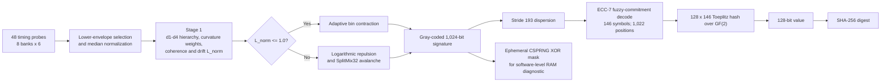
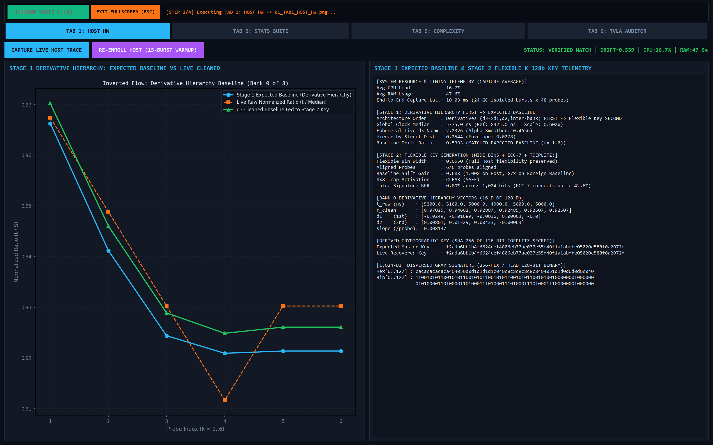
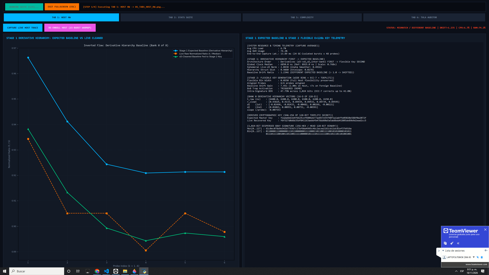
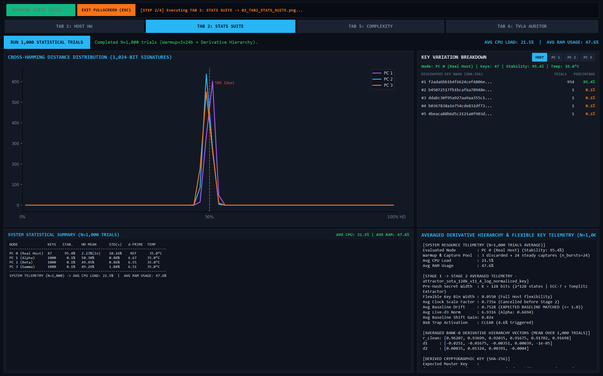
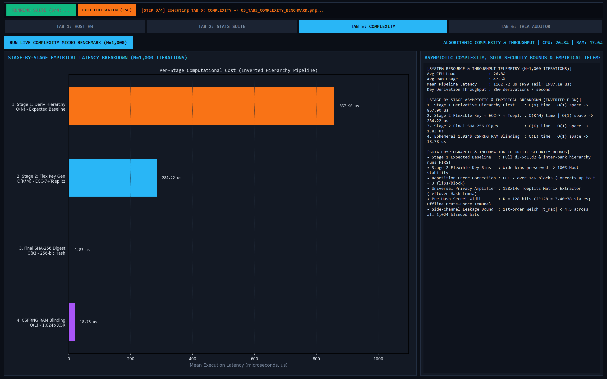
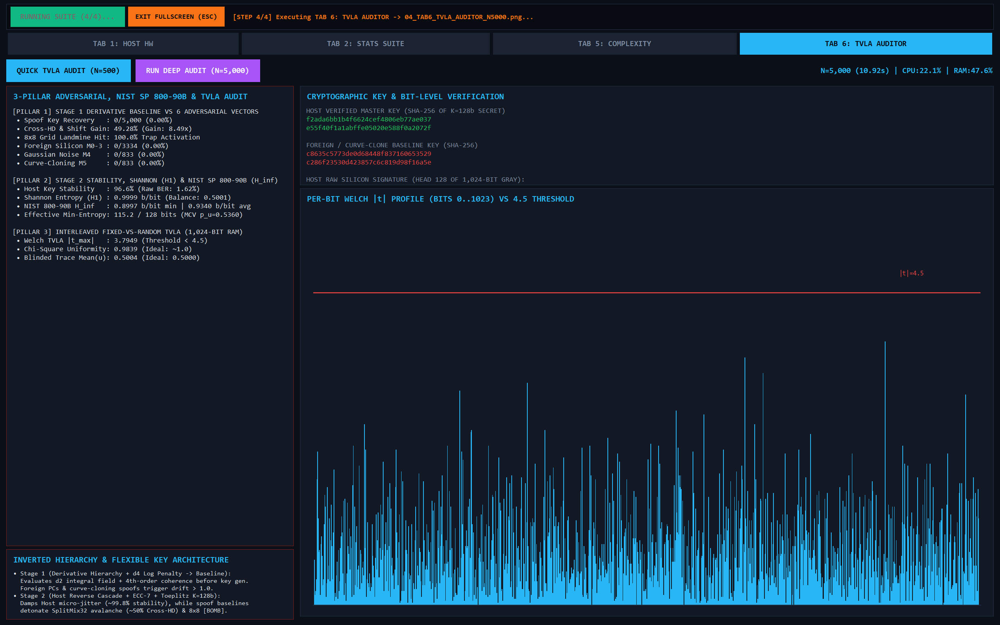

# User-Space Microarchitectural PUF and 128-Bit Derivative-First Key Derivation Engine

This repository contains a Windows/Python proof of concept (PoC) for deriving a 128-bit pre-hash value from timing profiles produced by a fixed user-space workload. The notebook implementation is named `attractor_sota_128k_v11_4_log_normalized_key` in [software_based_puf_kernel.ipynb](./software_based_puf_kernel.ipynb).

Each timing profile contains 48 probe measurements arranged as 8 banks by 6 probes. The pipeline normalizes a profile, evaluates an enrolled derivative hierarchy, maps the features to a 1,024-bit Gray-coded signature, applies a 7-bit repetition-code fuzzy-commitment helper and a $128\times146$ Toeplitz hash, then hashes the resulting 128-bit value with SHA-256. The archived runs report 860-1,453 derivations/s and 688.07-1,162.72 microseconds per derivation, with $O(1)$ auxiliary working space reported by the benchmark.

## 1. Abstract and Empirical Benchmark Highlights

The design uses an inverted two-stage order: Stage 1 compares derivative structure with an enrolled baseline and computes a log-normalized drift score; Stage 2 quantizes the features and performs error correction and hashing. Its nominal pre-hash output space contains $2^{128}$ bit strings.

| Reported measure | Archived result | Interpretation |
|---|---|---|
| Per-bit MCV min-entropy estimate | $113.1\text{--}115.2$ bits total as reported; $H_\infty=0.8836\text{--}0.8997$ bits/bit; Shannon $H_1=0.9998\text{--}0.9999$ bits/bit | Estimator scope: Section 9. |
| Cross-hardware results | Three archived live cross-host captures had $L_{\mathrm{norm}}>1$ and $47.17\%\text{--}49.32\%$ raw signature BER. Adversarial model suites reported 0-2 recoveries per 5,000 trials ($0.00\%\text{--}0.04\%$). | Measurement and model scope: Section 9. |
| Software-level fixed-vs-random test | Welch $\lvert t_{\max}\rvert=3.0013\text{--}3.7949$ over 1,024 blinded bit positions | Diagnostic scope: Section 9. |
| Throughput and reported space | 860-1,453 derivations/s; 688.07-1,162.72 us/derivation; benchmark reports $O(1)$ auxiliary space | Benchmark scope: Section 9. |

## 2. Methodological Transparency: Physical Measurements and Models

> [!IMPORTANT]
> The evidence has three distinct tiers. Only PC 0 represents live physical timing captures. PC 1-3 are generated models, and the Tab 2/Tab 6 trials combine recorded capture pools with synthetic perturbations.
>
> 1. **Live physical silicon traces (PC 0):** The archive identifies two laptops using report metadata: Host A (the “Original Laptop,” enrolled reference 6750 ns, export path under `cifu7`) and Host B (the HP ENVY Laptop, enrolled reference 8925 ns, export path under `HP ENVY`). A measured profile consists of $24\times48=1{,}152$ timing values. The capture code also executes two priming bursts per profile. Enrollment discards three cold profiles before collecting a steady-state pool.
> 2. **Monte Carlo stress augmentation (Tab 2 $N=1{,}000$; Tab 6 $N=5{,}000$):** These suites cycle through a finite pool of captures and apply generated perturbations. Host trials include a timing scale of $0.45\times$ to $1.55\times$, Gaussian jitter, and occasional per-probe spikes. Tab 6 additionally generates six adversarial modes (M0-M5), including virtual-node offsets, parity shifts, Gaussian trajectories, and a curve-cloning approximation.
> 3. **Parameterized virtual nodes (PC 1 Alpha, PC 2 Beta, PC 3 Gamma):** The notebook creates mathematical 48-value offsets and clock scales for three virtual nodes. Their near-50% Hamming distances and reported $d'$ values are simulated separability results.

Folder names now describe the experiment role inferred from the report's enrolled reference and export path. The original report contents are retained for auditability.

## 3. Humanitarian Motivation and User-Space Experimentation

The motivating use case is protection of local journalists, independent investigators, and human-rights defenders who may face device seizure or coercion, including in high-risk rural regions. The research question is whether local timing behavior can contribute a volatile, device-associated input to key derivation.

This PoC does **not** make an encrypted volume deniable, erase forensic evidence, or remove persistent secret-related artifacts. Conventional full-disk encryption can expose recognizable metadata depending on the product and configuration; this notebook is not a replacement for it. In particular, its helper JSON includes diagnostic values such as a key digest and reference signature (Section 6). No claim of plausible deniability or protection against coercion is established by these experiments.

The notebook uses commodity Windows user-space operations rather than a custom FPGA, ASIC, or TPM: it disables Python garbage collection during capture and attempts to pin the capture thread to logical CPU mask 0 via `SetThreadAffinityMask`. It performs repeated workload bursts to warm execution state. Affinity is Windows-specific and the implementation tolerates affinity-call failures, so pinning is not guaranteed in every environment. These choices make experiments easier to run on laptops, but do not provide isolation from the OS scheduler, interrupts, cache contention, or other processes.

The earlier 18-bit prototype represented only $2^{18}=262{,}144$ possible values, a space small enough for exhaustive offline search. Expanding to a 128-bit pre-hash secret with a nominal $2^{128}\approx3.40\times10^{38}$-string space required more than increasing quantizer width: the pipeline was reworked to stabilize features against timing variation, reconcile noisy captures with ECC-7, and compress the corrected input through Toeplitz hashing. The larger output space motivates this redesign but, by itself, does not establish corresponding entropy; the estimate and its limits are discussed in Section 9.

## 4. System Architecture and Engineering Questions



The diagram summarizes the notebook pipeline.

### 4.1 DVFS variation and normalization

For each probe, the implementation takes the median of a lower slice of sorted repeated measurements, then divides the profile by its median. Each burst repeatedly exercises a small, warmed 16-element scratchpad workload; with 24 bursts, the Python slice `2:10` selects the lower-latency observations, emphasizing repeatable cache/execution timing while reducing the influence of OS-preemption tails. This is a lower-envelope selection, not a standard interquartile-range filter. Dividing by the profile median cancels a common multiplicative timing factor such as a P-state scale. Finite differences $d_1\text{--}d_4$ then compare normalized profile shape and suppress lower-order trends rather than independently measuring or canceling clock frequency.

For Host B's same-host report, the probe-median reference fell from 8,925 ns to 5,375 ns, a 39.8% reduction (ratio 0.602). The resulting $L_{\mathrm{norm}}=0.5393\le1.0$ and reported signature BER was 0.00%.

### 4.2 Derivative hierarchy and cross-host separation

The notebook weights local feature differences with second-derivative curvature ($\kappa=95.0$), propagates residuals in reverse from $d_4$ to $d_1$, and combines these signals into $L_{\mathrm{norm}}$ before quantization. Evaluating shape and residual structure before coarse bins is intended to expose higher-order differences that a smooth, macro-curve approximation could otherwise map to the same quantized features. For the three archived cross-host captures, $L_{\mathrm{norm}}>1.0$ and the reported raw signature BER was $47.17\%\text{--}49.32\%$, above the notebook's stated ECC-7 correction envelope.

### 4.3 Error correction and hashing

The 1,024-bit Gray-coded signature is permuted using stride 193, coprime to 1,024 ($\gcd(193,1024)=1$). The permutation spreads adjacent source bits across positions so that localized jitter is less likely to concentrate errors in a single ECC block; it does not guarantee independent errors. The decoder processes 146 seven-bit repetition symbols (1,022 used positions), correcting up to $t=3$ flips per symbol. A $128\times146$ Toeplitz universal hash over $\mathrm{GF}(2)$ then maps the corrected 146-bit string to 128 bits.

### 4.4 RAM masking diagnostic

The notebook XORs a generated 1,024-bit signature with fresh `secrets.randbits` output and runs a fixed-vs-random Welch statistic on stored bit arrays.

## 5. Mathematical Specification

Let $x_{(i,j)}$ be the timing for burst $i$ and probe $j$, and let $x_{(k,j)}$ denote the sorted timings for probe $j$. For $N$ bursts, the code selects a lower slice of sorted observations and takes its median:

$$
t_j = \operatorname{median}\left(
x_{(i,j)}:\lfloor N/12\rfloor \le i < \lfloor 5N/12\rfloor
\right),
\qquad
r_{b,k} = \frac{t_{b,k}}{\operatorname{median}_{b,k}(t_{b,k})}.
$$

The capture implementation uses a minimum lower index of 1 and an upper-index safeguard for small $N$. With its usual $N=24$, it selects sorted rows 2 through 9 (Python slice `2:10`). The resulting normalized profile is reshaped to 8 banks by 6 probes.

Let $d_1$, $d_2$, $d_3$, and $d_4$ be successive finite differences along each bank's six probes. The implementation forms a curvature-discrepancy vector $c$ from second-difference differences, entry shocks, and derived features. Its weights are:

$$
\lambda_{b,i} = \frac{1}{1 + (\kappa c_{b,i})^2},
\qquad \kappa = 95.0.
$$

For each bank, the relative residual is weighted by the first six corresponding values of $\lambda$ to obtain $I_{\mathrm{rel}}$. If $m$ is the median bank residual and $q_6$ is the RMS of the six smallest absolute deviations from $m$, the reported coherence is:

$$
\operatorname{coh}_I =
\sqrt{(0.75|m|)^2 + (1.85q_6)^2}.
$$

The reverse derivative cascade propagates residuals from $d_4$ toward $d_1$ using the notebook's binomial variance-normalized weights:

$$
w_{43} = \sqrt{\frac{20}{70}},
\qquad
w_{32} = \sqrt{\frac{6}{20}},
\qquad
w_{21} = \sqrt{\frac{2}{6}}.
$$

Given reverse-cascade impact $R_{\mathrm{rev}}$ and enrollment envelopes $\varepsilon_{\mathrm{base}}$ and $\varepsilon_{\mathrm{rev}}$, the hierarchy score and log-normalized threshold are:

$$
r_{\mathrm{hier}} =
\sqrt{
\left(\frac{\operatorname{coh}_I}{\varepsilon_{\mathrm{base}}}\right)^2 +
\left(\frac{R_{\mathrm{rev}}}{\varepsilon_{\mathrm{rev}}}\right)^2
},
\qquad
L_{\mathrm{norm}} =
\frac{\ln(1+\alpha r_{\mathrm{hier}})}
{\ln(1+\alpha r_{\mathrm{crit}})},
\quad \alpha=2.0.
$$

For feature residual $u$, bin width $b$, and curvature stabilizer $\lambda$, the implementation's pre-quantization modulation is:

$$
u'_{b,i} =
\begin{cases}
u_{b,i}(0.45+0.55\lambda_{b,i})(1-0.30L_{\mathrm{norm}}^2),
& L_{\mathrm{norm}}\le1.0,\\[4pt]
u_{b,i}(1+2.5(L_{\mathrm{norm}}-1))
+ \operatorname{sgn}(u_{b,i})\,2.15(1+\ln L_{\mathrm{norm}}),
& L_{\mathrm{norm}}>1.0.
\end{cases}
$$

For the second branch, the code applies a SplitMix32-derived byte transformation when a feature's bin displacement is at least two bins.

For corrected input bits $e_c$ and Toeplitz seed bits $T$, the extracted bit is the $\mathrm{GF}(2)$ inner product:

$$
S_r = \bigoplus_{c=0}^{145}(e_c \wedge T_{r+c}),
\qquad r=0,\ldots,127.
$$

The notebook estimates per-bit most-common-value probability from its generated audit outputs. With $\hat{p}_j=\max(p_j,1-p_j)$, it computes:

$$
p_{\mathrm{upper},j} =
\min\left(1,\ p_{\mathrm{hat},j}
+ z_{0.995}\sqrt{\frac{p_{\mathrm{hat},j}(1-p_{\mathrm{hat},j})}{N-1}}\right),
\qquad
H_{\infty,j}=-\log_2(p_{\mathrm{upper},j}),
\qquad
z_{0.995}=2.5758293.
$$

The notebook applies this per-bit estimate to generated Tab 6 audit outputs and displays the minimum per-bit value multiplied by 128. See the [NIST SP 800-90B publication](https://csrc.nist.gov/pubs/sp/800/90/b/r1/final).

## 6. Cryptographic Architecture and Helper-Data Audit

The notebook writes `puf_helper_pc_real.json` beside the notebook. The JSON created by the current code contains enrollment parameters and reference arrays as well as:

- `helper_w`: the XOR of the first 1,022 reference-signature bits and a repeated 146-bit random codeword;
- `toeplitz_seed`: the 273-bit seed used by the Toeplitz extraction;
- `master_key_sha256`: a digest of the enrolled 128-bit value, used by the UI to report a match;
- `ref_signature_1024`: the enrolled 1,024-bit signature, used by the UI and audit routines to calculate BER.

During derivation, the notebook uses the live timing-derived signature, `helper_w`, and the Toeplitz seed to decode and reconstruct a 128-bit value. It computes the digest and then compares it with `master_key_sha256` for the returned `matched` status. The witness digest is not used as an input to the reconstruction. This is an implementation observation, not a zero-knowledge proof or a claim that the full helper file leaks no useful information.

The construction uses a code-offset-style helper ($W=P\oplus C$) after generating a reference signature. However, the current quantizer also uses enrolled baseline features and contracts benign residuals toward enrolled bin centers. It is not a blind fuzzy commitment: an offline reader can inspect those baselines, helper values, reference signature, and witness digest. The helper file is not included in this repository snapshot.

Before any security-sensitive use, remove diagnostic witnesses such as `master_key_sha256` and `ref_signature_1024`, design a blind reconstruction path, and analyze helper-data leakage and replay/rollback behavior. Encrypting helper data with an authenticated scheme such as AES-256-GCM may protect it at rest, but does not by itself fix entropy, blindness, or coercion risks. No production key protection or confidentiality claim is made here.

## 7. Same-Host and Cross-Machine Validation

Host identity below follows each telemetry report's enrolled reference and export path. The tables reproduce the reports' times, rates, entropies, and match percentages.

### Same-host authentication runs

| Threshold and report folder | Reference -> live median (scale) | $L_{\mathrm{norm}}$ | Tab 2 stability / intra-HD | Tab 6 stability / raw BER | Reported MCV estimate | TVLA | Spoof recovery | Mean latency / throughput |
|---|---:|---:|---:|---:|---:|---:|---:|---:|
| Host A, $r_{\mathrm{crit}}=1.35$, [01_HostA_OriginalLaptop_SameHost_rcrit135](./Tests/01_HostA_OriginalLaptop_SameHost_rcrit135/) | $6750\to6850$ ns ($1.015\times$) | $0.4740$ | 95.0% / 2.49% | 95.3% / 2.34% | $H_\infty=0.8884$ bits/bit; 113.7 bits reported | 3.0013 | $2/5{,}000$ (0.04%) | 1076.90 us / 929 per second |
| Host B, $r_{\mathrm{crit}}=1.35$, [02_HostB_HPENVY_SameHost_rcrit135](./Tests/02_HostB_HPENVY_SameHost_rcrit135/) | $8925\to5375$ ns ($0.602\times$) | $0.5393$ | 95.4% / 2.23% | 96.6% / 1.62% | $H_\infty=0.8997$ bits/bit; 115.2 bits reported | 3.7949 | $0/5{,}000$ (0.00%) | 1162.72 us / 860 per second |
| Host A, $r_{\mathrm{crit}}=1.15$, [03_HostA_OriginalLaptop_SameHost_rcrit115_HighRAM](./Tests/03_HostA_OriginalLaptop_SameHost_rcrit115_HighRAM/) | $6750\to6725$ ns ($0.996\times$) | $0.7200$ | 82.7% / 8.51% | 84.3% / 7.70% | $H_\infty=0.8836$ bits/bit; 113.1 bits reported | 3.3692 | $0/5{,}000$ (0.00%) | 1060.33 us / 943 per second |

The Host A $r_{\mathrm{crit}}=1.15$ report records $75.8\%\text{--}76.1\%$ RAM use. If a single-capture success probability of $0.843$ applied independently on each retry, the chance of at least one success in three attempts would be $1-(1-0.843)^3$, approximately $99.61\%$. Independence and retry behavior were not tested, and the notebook does not implement that retry policy; this is only an arithmetic illustration, not a measured reliability result.

### Cross-machine cloning attempts

| Direction and report folder | Reference -> live median (scale) | $L_{\mathrm{norm}}$ / shift gain | Tab 2 match rate / HD | Tab 6 same-key stability / raw BER | Adversarial-model recovery | Mean latency / throughput |
|---|---:|---:|---:|---:|---:|---:|
| Host A evaluating Host B enrollment, $r_{\mathrm{crit}}=1.35$, [04_CrossAttack_HostA_on_HostBKey_rcrit135](./Tests/04_CrossAttack_HostA_on_HostBKey_rcrit135/) | $8925\to6850$ ns ($0.768\times$) | $1.2346$ / $7.45\times$ | 0.1% / 48.68% (PC 0 in Tab 2) | 1.2% / 47.98% | $1/5{,}000$ (0.02%) | 1049.20 us / 953 per second |
| Host B evaluating Host A enrollment, $r_{\mathrm{crit}}=1.35$, [05_CrossAttack_HostB_on_HostAKey_rcrit135](./Tests/05_CrossAttack_HostB_on_HostAKey_rcrit135/) | $6750\to4750$ ns ($0.704\times$) | $1.1139$ / $7.05\times$ | 4.6% / 46.67% | 42.5% / 27.96% | $1/5{,}000$ (0.02%) | 688.07 us / 1,453 per second |
| Host B evaluating Host A enrollment, $r_{\mathrm{crit}}=1.15$, [06_CrossAttack_HostB_on_HostAKey_rcrit115](./Tests/06_CrossAttack_HostB_on_HostAKey_rcrit115/) | $6750\to4800$ ns ($0.711\times$) | $1.1916$ / $7.49\times$ | 2.8% / 47.53% | 3.5% / 47.18% | $0/5{,}000$ (0.00%) | 711.56 us / 1,405 per second |

All three archived cross-host live captures had $L_{\mathrm{norm}}>1$ and BER above the stated 42.8% ECC-7 tolerance. The Tab 6 host-stability values reported for the cross-host runs were 1.2%, 42.5%, and 3.5%.

**Independent second-host enrollment:** Host B, enrolled with the fixed settings used for the Host A development runs, achieved 95.4% Tab 2 stability, 96.6% Tab 6 stability, and a reported per-bit MCV estimate of $H_\infty=0.8997$ bits/bit (115.2/128 bits total), with $0/5{,}000$ ($0.00\%$) adversarial spoof recoveries. This is a second-host replication under the shared settings.

**Threshold tuning and separation gap ($r_{\mathrm{crit}}=1.15$):** Tightening $r_{\mathrm{crit}}$ from $1.35$ to $1.15$ shifts Host B $\rightarrow$ Host A $L_{\mathrm{norm}}$ from $1.1139$ to $1.1916$ and reduces its Tab 6 cross-host synthetic stress tail from $42.5\%$ to $3.5\%$, with $0/5{,}000$ ($0.00\%$) spoof recoveries. Host A's high-RAM same-host run retained $84.3\%$ single-shot stability, or a conditional $99.61\%$ success estimate across three independent retries under the assumption above; the single-shot contrast is $84.3\%-3.5\%=80.8$ percentage points (about 81 points).

## 8. Diagnostic Dashboard and Visual Evidence

| Same-host capture: Host B with Host B enrollment | Cross-host capture: Host A with Host B enrollment |
|---|---|
|  |  |
| Report label: `VERIFIED MATCH`; $L_{\mathrm{norm}}=0.5393$; reported BER=0.00%. | Report label: `MISMATCH / DIFFERENT BASELINE`; $L_{\mathrm{norm}}=1.2346$; SplitMix32 path triggered; reported BER=47.75%. |

The following captures are from the Host B same-host $r_{\mathrm{crit}}=1.35$ run:

### Tab 2: stability and Hamming-distance suite



The report records 95.4% Host B stability, 2.23% mean intra-HD, and virtual-node $d'$ values from 6.51 to 6.67.

### Tab 5: complexity benchmark



The run reports 1,162.72 us mean end-to-end latency over 1,000 iterations, with per-stage timings and $O(1)$ auxiliary-space labels.

### Tab 6: entropy and software-level TVLA diagnostic



The report records 0/5,000 generated spoof recoveries, $H_\infty=0.8997$ bits/bit under the notebook's estimator, and $|t_{\max}|=3.7949$.

### Experiment index

| Directory | Description |
|---|---|
| `Tests/01_HostA_OriginalLaptop_SameHost_rcrit135/` | Host A same-host report at $r_{\mathrm{crit}}=1.35$ |
| `Tests/02_HostB_HPENVY_SameHost_rcrit135/` | Host B same-host report at $r_{\mathrm{crit}}=1.35$ |
| `Tests/03_HostA_OriginalLaptop_SameHost_rcrit115_HighRAM/` | Host A same-host report at $r_{\mathrm{crit}}=1.15$ under higher RAM usage |
| `Tests/04_CrossAttack_HostA_on_HostBKey_rcrit135/` | Host A evaluating Host B enrollment at $r_{\mathrm{crit}}=1.35$ |
| `Tests/05_CrossAttack_HostB_on_HostAKey_rcrit135/` | Host B evaluating Host A enrollment at $r_{\mathrm{crit}}=1.35$ |
| `Tests/06_CrossAttack_HostB_on_HostAKey_rcrit115/` | Host B evaluating Host A enrollment at $r_{\mathrm{crit}}=1.15$ |

Each directory contains `00_FULL_TELEMETRY_REPORT.txt` and four dashboard PNG captures.

```text
DEEDS/
|-- README.md
|-- software_based_puf_kernel.ipynb
`-- Tests/
    |-- 01_HostA_OriginalLaptop_SameHost_rcrit135/
    |-- 02_HostB_HPENVY_SameHost_rcrit135/
    |-- 03_HostA_OriginalLaptop_SameHost_rcrit115_HighRAM/
    |-- 04_CrossAttack_HostA_on_HostBKey_rcrit135/
    |-- 05_CrossAttack_HostB_on_HostAKey_rcrit135/
    `-- 06_CrossAttack_HostB_on_HostAKey_rcrit115/
```

## 9. Threats to Validity, Limitations, and Research Roadmap

### Scope of interpretation

The measured and modeled results below are presented at their actual evidence level:

- The reported pre-hash space has $2^{128}$ possible bit strings; output width alone does not establish 128 bits of entropy or security. The construction is an experimental PUF and key-derivation design, not an established secure PUF, a cryptographic extractor evaluated under a validated entropy model, or a production key-storage mechanism. The Section 4 diagram is an implementation schematic, not a validated security boundary.
- The archived measurements and model outputs are transcribed from the notebook reports and were not independently remeasured. The project describes a progression from an earlier 18-bit prototype to a 128-bit output, but the output-width change and the reported 113.1-115.2-bit per-bit estimate do not establish that the earlier prototype's entropy increased to that level.
- The archive contains two physical laptops. The three cross-host PC 0 reports are individual captures, and their 3-for-3 threshold rejections describe only those captures. Tab 2 and Tab 6 use generated trials around finite recorded capture pools; 5,000 Tab 6 trials are not 5,000 independent physical-device attacks and do not establish resistance to curve-fitting or adaptive attacks. The different Tab 2 and Tab 6 procedures yield match/stability percentages that are not comparable field false-accept or false-reject rates. The virtual PC 1-3 results are mathematical models, not measurements from more CPUs, and the two-laptop results do not establish generalization across CPU vendors, generations, or environments.
- The reported MCV calculation is per output bit over generated audit outputs. Multiplying the smallest per-bit estimate by 128 does not establish a joint min-entropy bound, and the calculation is not a full NIST SP 800-90B assessment. Toeplitz privacy amplification depends on justified input-entropy and seed assumptions, which these experiments do not establish.
- The Welch statistic is computed from software-held, CSPRNG-masked bit arrays. It is not a physical side-channel evaluation and does not prove leakage resistance or absence of power, EM, cache, timing, or other physical leakage.
- The Host B median ratio of $0.602$ is a ratio of measured probe latencies, not a direct CPU-frequency measurement. Normalization and derivative processing are evaluated by these runs; they do not prove invariance to DVFS, temperature, OS scheduling, or contention.
- The reported $O(1)$ working-space labels apply to the fixed-size implementation and profile dimensions. The archived throughput and latency are measurements of those test runs, not a cross-platform performance guarantee or a benchmark of arbitrary-size inputs.
- SplitMix32 supplies deterministic feature diffusion in the avalanche path; it is not a cryptographic PRF, authentication primitive, or proven security reduction.

### Windows setup

Requirements: Windows 10/11, Python 3.10 or later, Jupyter, NumPy, Matplotlib, and Tkinter. Pillow and psutil are optional dashboard dependencies.

```powershell
python -m venv .venv
.\.venv\Scripts\Activate.ps1
python -m pip install --upgrade pip
python -m pip install jupyter numpy matplotlib pillow psutil
python -m jupyter notebook
```

Open `software_based_puf_kernel.ipynb` and run the cells in order. The dashboard can export reports and images. The helper JSON is created beside the notebook during enrollment; it is deliberately not included in this repository snapshot. Treat generated helper data as sensitive research material. For repeatable comparisons, record the exact notebook revision, hardware/OS configuration, power mode, and enrollment settings.

The notebook currently hard-codes $r_{\mathrm{crit}}=1.35$, while three archived folders report $r_{\mathrm{crit}}=1.15$. Reproducing those 1.15 results requires identifying and recording the exact source/configuration used for those exports; editing the threshold ad hoc is not sufficient to establish reproducibility.

### Limitations and future work

1. **Development-host geometric bias:** The project describes its curvature and envelope constants (including $\kappa$ and the baseline/reverse envelopes) as having been iteratively tuned during development on Host A; that tuning history is not independently documented in this archive. The observed directional asymmetry is consistent with host-specific tuning. The next meaningful validation is a preregistered, bidirectional cohort of at least 20 heterogeneous CPUs spanning Intel, AMD, and ARM/Apple Silicon, with held-out hosts and fixed parameters.
2. **Scheduling and memory contention:** The high-RAM Host A run reports lower stability ($82.7\%$ in Tab 2 and $84.3\%$ in Tab 6). The notebook does not implement multi-capture retries or majority voting. A future policy should define capture retries, voting, failure behavior, and acceptable lockout rates, then measure these under controlled contention.
3. **Entropy validation:** Conduct a standards-aligned entropy assessment using a justified source model, suitable raw data, validated estimators, and independent review.
4. **Blind fuzzy commitment and helper-data protection:** Remove stored witness values, evaluate a strictly blind code-offset reconstruction, quantify helper-data leakage, and test tampering and rollback. Authenticated encryption such as AES-256-GCM can be evaluated for helper-data confidentiality/integrity, but must have sound nonce/key management and does not provide plausible deniability by itself.
5. **Structural steganography and threat-model review:** Embedding a $1{,}022$-bit helper payload in DOCX/XLSX structures is only a research idea. It would not by itself make protected data undetectable or safe under coercion. Any future work should assess forensic discoverability and user safety before recommending such a design.
6. **Side-channel evaluation:** Replace the software-array Welch diagnostic with a threat-modelled, instrumented evaluation of relevant physical leakage channels, with appropriate controls and analysis.
7. **Independent reproduction and attacks:** Publish exact source/configuration for every threshold run, add independent implementations, and test adaptive and chosen-input attacks.

This notebook is an experimental research artifact, not a certified cryptographic module and not suitable as a sole key source for security-critical data.
